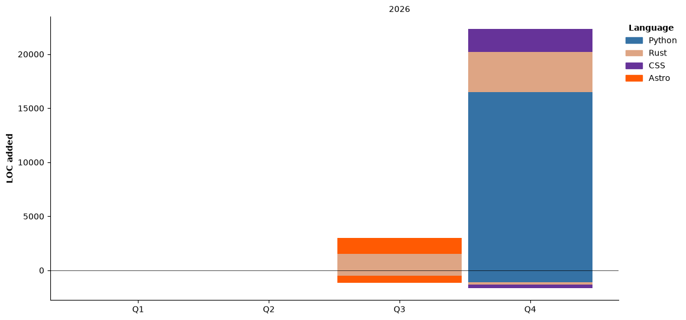

## Hi there 👋

# I'm Gohan_taberu

Computer Science Student @ HNU

<a href="https://wakatime.com/@589fce8a-5dd9-46fc-9a59-d10d4bde6c65"></a>

## ⌨️ Coding Activity

<!--START_SECTION:waka-->


**🐱 My GitHub Data** 

> 📦 4.2 kB Used in GitHub's Storage 
 > 
> 🏆 87 Contributions in the Year 2026
 > 
> 🚫 Not Opted to Hire
 > 
> 📜 9 Public Repositories 
 > 
> 🔑 1 Private Repositories 
 > 
**I'm an Early 🐤** 

```text
🌞 Morning                21 commits          ██████░░░░░░░░░░░░░░░░░░░   22.34 % 
🌆 Daytime                40 commits          ███████████░░░░░░░░░░░░░░   42.55 % 
🌃 Evening                33 commits          █████████░░░░░░░░░░░░░░░░   35.11 % 
🌙 Night                  0 commits           ░░░░░░░░░░░░░░░░░░░░░░░░░   00.00 % 
```
📅 **I'm Most Productive on Wednesday** 

```text
Monday                   11 commits          ███░░░░░░░░░░░░░░░░░░░░░░   11.70 % 
Tuesday                  27 commits          ███████░░░░░░░░░░░░░░░░░░   28.72 % 
Wednesday                30 commits          ████████░░░░░░░░░░░░░░░░░   31.91 % 
Thursday                 15 commits          ████░░░░░░░░░░░░░░░░░░░░░   15.96 % 
Friday                   2 commits           █░░░░░░░░░░░░░░░░░░░░░░░░   02.13 % 
Saturday                 8 commits           ██░░░░░░░░░░░░░░░░░░░░░░░   08.51 % 
Sunday                   1 commits           ░░░░░░░░░░░░░░░░░░░░░░░░░   01.06 % 
```


📊 **This Week I Spent My Time On** 

```text
🕑︎ Time Zone: Asia/Shanghai

💬 Programming Languages: 
Rust                     9 hrs 56 mins       ████████████░░░░░░░░░░░░░   48.80 % 
C++                      7 hrs 18 mins       █████████░░░░░░░░░░░░░░░░   35.87 % 
Other                    2 hrs 34 mins       ███░░░░░░░░░░░░░░░░░░░░░░   12.63 % 
Git Config               18 mins             ░░░░░░░░░░░░░░░░░░░░░░░░░   01.49 % 
TOML                     9 mins              ░░░░░░░░░░░░░░░░░░░░░░░░░   00.80 % 

🔥 Editors: 
Cursor                   20 hrs 23 mins      █████████████████████████   100.00 % 
```

🤖 **AI Coding This Week** 

```text
⏱ AI Coding Time: 5 hrs 5 mins (24.99%)

✍️ 325 lines written by AI, 713 lines written by hand (31.31% AI-written)

🔤 1,089,027 Input Tokens, 42,047 Output Tokens

💵 $4.67 Estimated AI Cost This Week

🧠 10 AI Sessions, 93 AI Prompts

GPT                      325 lines           █████████████████████████   100.00 % 

🔎 AI Coding Insights:
🧑‍💻 Mostly Hands-On — 31.31% of written lines came from AI
📝 Concise Prompter — average 86 characters per prompt
🔁 Iterative Prompter — average 9 prompts per session
🔍 Hands-On Reviewer — 74.53% of changed lines were hand-edited
```

**I Mostly Code in Rust** 

```text
Rust                     4 repos             ██████████████░░░░░░░░░░░   57.14 % 
Python                   1 repo              ████░░░░░░░░░░░░░░░░░░░░░   14.29 % 
CSS                      1 repo              ████░░░░░░░░░░░░░░░░░░░░░   14.29 % 
Astro                    1 repo              ████░░░░░░░░░░░░░░░░░░░░░   14.29 % 
```


**Timeline**




 Last Updated on 24/11/2026 22:26:46 UTC
<!--END_SECTION:waka-->