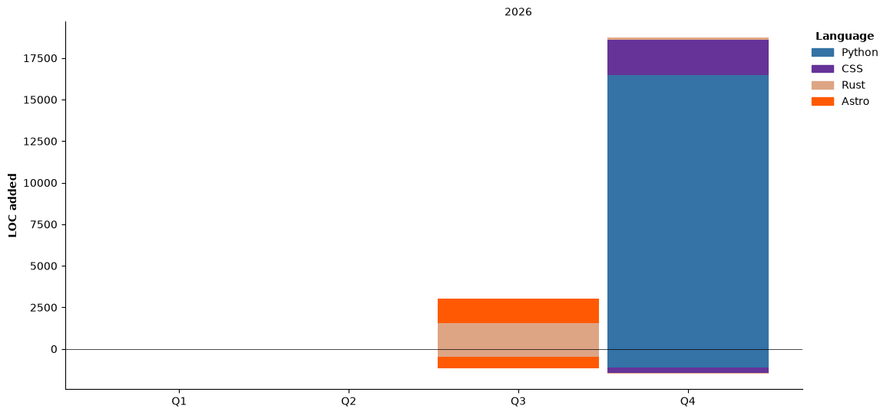

## Hi there 👋

# I'm Gohan_taberu

Computer Science Student @ HNU

<a href="https://wakatime.com/@589fce8a-5dd9-46fc-9a59-d10d4bde6c65"></a>

## ⌨️ Coding Activity

<!--START_SECTION:waka-->


**🐱 My GitHub Data** 

> 📦 3.8 kB Used in GitHub's Storage 
 > 
> 🏆 56 Contributions in the Year 2026
 > 
> 🚫 Not Opted to Hire
 > 
> 📜 6 Public Repositories 
 > 
> 🔑 1 Private Repositories 
 > 
**I'm an Early 🐤** 

```text
🌞 Morning                10 commits          █████░░░░░░░░░░░░░░░░░░░░   19.23 % 
🌆 Daytime                25 commits          ████████████░░░░░░░░░░░░░   48.08 % 
🌃 Evening                17 commits          ████████░░░░░░░░░░░░░░░░░   32.69 % 
🌙 Night                  0 commits           ░░░░░░░░░░░░░░░░░░░░░░░░░   00.00 % 
```
📅 **I'm Most Productive on Tuesday** 

```text
Monday                   8 commits           ████░░░░░░░░░░░░░░░░░░░░░   15.38 % 
Tuesday                  16 commits          ████████░░░░░░░░░░░░░░░░░   30.77 % 
Wednesday                6 commits           ███░░░░░░░░░░░░░░░░░░░░░░   11.54 % 
Thursday                 11 commits          █████░░░░░░░░░░░░░░░░░░░░   21.15 % 
Friday                   2 commits           █░░░░░░░░░░░░░░░░░░░░░░░░   03.85 % 
Saturday                 8 commits           ████░░░░░░░░░░░░░░░░░░░░░   15.38 % 
Sunday                   1 commits           ░░░░░░░░░░░░░░░░░░░░░░░░░   01.92 % 
```


📊 **This Week I Spent My Time On** 

```text
🕑︎ Time Zone: Asia/Shanghai

💬 Programming Languages: 
Markdown                 21 hrs 3 mins       ████████████░░░░░░░░░░░░░   47.92 % 
C++                      16 hrs 9 mins       █████████░░░░░░░░░░░░░░░░   36.78 % 
Python                   4 hrs 36 mins       ███░░░░░░░░░░░░░░░░░░░░░░   10.50 % 
Other                    48 mins             ░░░░░░░░░░░░░░░░░░░░░░░░░   01.85 % 
JavaScript               35 mins             ░░░░░░░░░░░░░░░░░░░░░░░░░   01.33 % 

🔥 Editors: 
Cursor                   41 hrs 5 mins       ███████████████████████░░   93.49 % 
VS Code                  2 hrs 51 mins       ██░░░░░░░░░░░░░░░░░░░░░░░   06.51 % 
```

🤖 **AI Coding This Week** 

```text
⏱ AI Coding Time: 22 hrs 18 mins (50.75%)

✍️ 1,908 lines written by AI, 511 lines written by hand (78.88% AI-written)

🔤 2,567,044 Input Tokens, 226,985 Output Tokens

💵 $16.03 Estimated AI Cost This Week

🧠 10 AI Sessions, 93 AI Prompts

GPT                      1,941 lines         █████████████████████████   100.00 % 

🔎 AI Coding Insights:
🤖 AI-Driven — 78.88% of written lines came from AI
📝 Concise Prompter — average 91 characters per prompt
🔁 Iterative Prompter — average 9 prompts per session
🚀 High AI Trust — 33.07% of changed lines were hand-edited
```

**I Mostly Code in Rust** 

```text
Rust                     3 repos             ███████████████░░░░░░░░░░   60.00 % 
CSS                      1 repo              █████░░░░░░░░░░░░░░░░░░░░   20.00 % 
Astro                    1 repo              █████░░░░░░░░░░░░░░░░░░░░   20.00 % 
```


**Timeline**




 Last Updated on 01/11/2026 17:56:05 UTC
<!--END_SECTION:waka-->